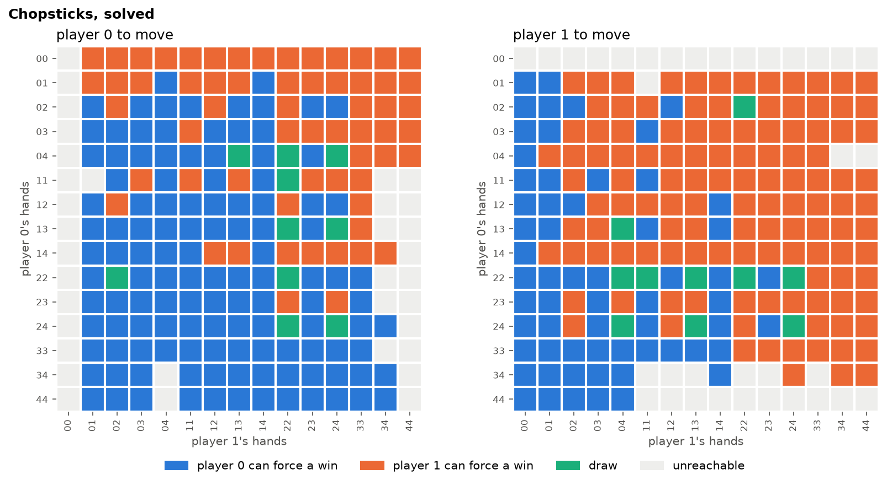

# Optimal Play in Chopsticks

This started after a game of chopsticks with someone: is there any real strategy, or does the game just go round in circles until someone messes up? The game is small enough to brute-force, so rather than think about it too hard, I just checked with code.

**The answer: the second player can always force a win.** Only 20 of the 382 reachable positions are draws, and they form one narrow loop that's very easy to fall off.



The full write-up, including how many positions there should be and why some can never happen, is in [notes/findings.md](notes/findings.md). The notebook [notebooks/main.ipynb](notebooks/main.ipynb) has the code behind every number and plot.

## How it works

Every legal position (both players' hands plus whose turn it is) is a node in a graph, and every legal move is an edge. A breadth-first search from `(1, 1)` vs `(1, 1)` finds all reachable positions.

Then for each player we compute an **attractor**: the positions from which they can force a win. It's built backwards from finished games:

- A_0 is the set of positions where the player has already won.
- A position joins A_{k+1} if it's the player's turn and *some* move lands in A_k, or it's the opponent's turn and *every* move does.

The layer k at which a position joins is the number of moves the winner needs. Positions in neither attractor are draws.

## Play against the bot

There's a bot that plays perfectly. It takes the fastest win when it has one, and drags the game out as long as it can when it doesn't.

```bash
pip install -e .
chopsticks            # you go second, so you can win (if you find the line)
chopsticks --first    # you go first, so you will lose
chopsticks --hints    # shows who can force a win before each move
```

Each turn you get a numbered list of your moves:

```text
  bot: (1, 1)
  you: (1, 1)

  1. tap     their (1, 1) -> (2, 1)
  2. split   your (1, 1) -> (0, 2)
your move:
```

## Quick start

```bash
git clone https://github.com/dbruwel/chopsticks-optimal-play.git
cd chopsticks-optimal-play
pip install -e .
```

Then in Python:

```python
from chopsticks_optimal_play import (
    ChopsticksGame,
    build_adjacency_matrix,
    compute_attractor,
)

start = ChopsticksGame()
adjacency, nodes = build_adjacency_matrix(start)
player_1 = compute_attractor(adjacency, nodes, player=1)

print(f"Reachable states: {len(nodes)}")             # 382
print(f"Player 1 wins from the start in {player_1[0]} moves")  # 26
```

To run the notebook or the tests:

```bash
pip install -e ".[notebook,dev]"
jupyter lab notebooks/main.ipynb
pytest
```

## Repository layout

```text
chopsticks-optimal-play/
├── notebooks/
│   └── main.ipynb          # the exploration: plots, the opening, the draw loop
├── notes/
│   ├── findings.md         # the write-up
│   └── img/                # figures exported from the notebook
├── src/
│   └── chopsticks_optimal_play/
│       ├── __init__.py
│       ├── bot.py          # the optimal bot
│       ├── game.py         # game rules, graph search and attractors
│       └── play.py         # play against the bot in the terminal
├── tests/
│   └── test_game.py        # rule checks and the headline result
├── LICENSE
├── README.md
└── pyproject.toml
```

## License

MIT License. See the [LICENSE](LICENSE) file for details.
