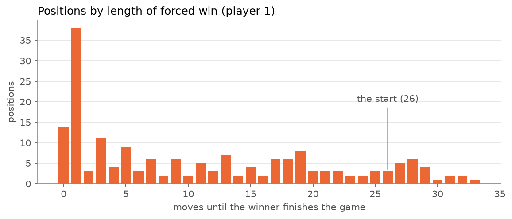
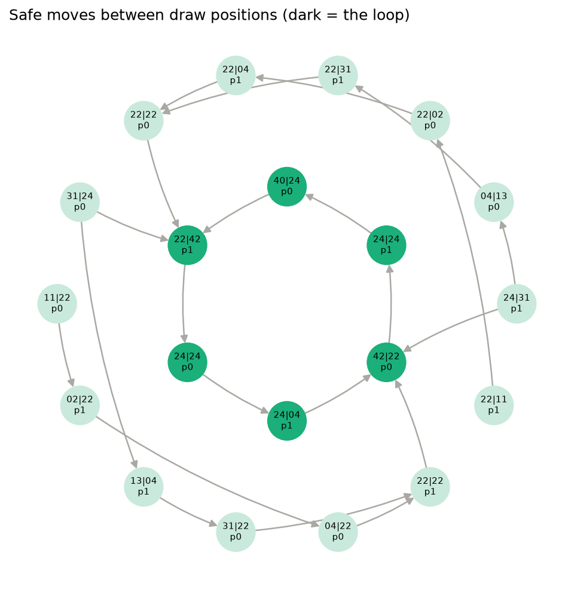

# Chopsticks

This started after a game of chopsticks with someone, I noticed that we often got stuck in loops, but thinking about the game, it felt like working backwards from a winning state, you could push things pretty far, so I was curious if there is any real strategy, or does perfect play just end in a loop. The game is small enough to solve by brute force instead of thinking hard about it, so that's what this is.

**Summary:** the second player can always force a win. Going first is a
(slow) loss.

The numbers below all come from [`notebooks/main.ipynb`](../notebooks/main.ipynb),
which has the code and more plots.

## The rules used

There are lots of house rules for chopsticks. This project uses:

- Each player starts with one finger up on each hand: `(1, 1)` vs `(1, 1)`.
- **Tap:** hit one of your opponent's live hands with one of your live hands. Their
  hand gains your number of fingers. If it reaches 5 or more, it's dead (back to 0).
- **Split:** move fingers between your own hands, keeping both at 4 or less. Just
  swapping your hands round doesn't count as a move. You *can* split onto a dead hand
  to bring it back.
- Dead hands can't tap and can't be tapped.
- You lose when both your hands are dead.

## How many positions are there?

A position is both players' hands plus whose turn it is.

- Each hand shows 0 to 4 fingers, so **5** options per hand.
- Left and right don't matter, so one player's hands are an unordered pair:
  $\binom{5+1}{2} = 15$ options (versus $5^2 = 25$ if order mattered).
- Two players and a turn: $15 \times 15 \times 2 = \mathbf{450}$ positions.

Some of those can't happen:

| | positions |
|---|---:|
| every combination of hands and turn | 450 |
| minus: both players knocked out | −2 |
| minus: game over but the *winner* is to move (you only lose a hand on your opponent's turn) | −28 |
| **plausible on paper** | **420** |
| actually reachable from `(1, 1)` vs `(1, 1)` | **382** |

So 38 positions are legal-looking but never come up. They mostly involve someone
holding `(4, 4)` or `(3, 4)`. If your opponent is holding big numbers, whatever they
hit you with is big too, so you can't be left holding small numbers straight after
their turn.

Out of those 382 positions there are 1000 legal moves in total, 2.6 per position on
average and never more than 6. The game is tiny.

## winning conditions

From each position we work out whether someone can **force** a win, meaning they win
whatever the other player does. This is done backwards from the finished games
(the "attractor" for each player):

- Start with the positions where the player has already won.
- Add a position if it's the player's turn and **some** move gets into the set, or
  it's the opponent's turn and **every** move does.
- Repeat until nothing changes.

The round a position gets added in is how many moves the winner needs to finish,
assuming the loser drags it out as long as possible. Anything left over is a
**draw**: with good play from both sides, the game never ends.

| outcome | positions |
|---|---:|
| player 0 (first player) can force a win | 181 |
| player 1 (second player) can force a win | 181 |
| draw | 20 |

The two players get exactly the same number because the game is symmetric: swap the
hands and flip the turn and you get the mirror-image position.


### Going second wins

The opening position is in **player 1's** attractor. Whatever player 0 does, player
1 can force a win in at most **26 moves** (13 each).

It isn't an easy win to find, though. Player 0's best try is to tap, giving
`(1, 1)` vs `(2, 1)`. Player 1 then has three replies, and **two of them lose**:

| player 1 replies with | result |
|---|---|
| tap, giving `(2, 1)` vs `(2, 1)` | player 0 wins |
| tap, giving `(3, 1)` vs `(2, 1)` | player 0 wins |
| split `(2, 1)` into `(0, 3)` | **player 1 wins** |

The only winning reply is to kill one of your own hands on move one. Probably not
what most people would go for.

### Being the one to move is usually good

Of the 354 unfinished positions, the player to move can force a win in 240, loses in
94, and draws in 20. Most of the time there's a good move available. It just happens
that the opening is one of the exceptions.

### Long wins

Most forced wins are quick: 38 positions are "win next move". There's a long tail,
though, and the longest forced win in the game is 33 moves, starting from
`(1, 1)` vs `(1, 3)` with player 1 to move.



## The draws (where the game loops forever)

Only 20 positions are draws, and they're hard to stay in. In 18 of them there's
exactly **one** move that doesn't lose. Every other move puts you in your opponent's
winning set.

If you follow the non-losing moves around, they all feed into a single loop of six
positions:

```text
24|24 -> 24|04 -> 42|22 -> 24|24 -> 40|24 -> 22|42 -> back to the start
```

(`p0 hands | p1 hands`.) Each player in turn kills one of the other's hands, the
victim splits back to `(2, 2)`, and then gets bumped back up to `(2, 4)`. Two perfect
players who end up here would be at it forever.



You can't get here from the opening without someone making a mistake, since the
opening is a forced win for player 1.

## Random playing

Simulating 10,000 games each:

| player 0 | player 1 | player 0 wins | player 1 wins |
|---|---|---:|---:|
| random | random | 40% | **60%** |
| perfect | random | **100%** | 0% |
| random | perfect | 0% | **100%** |
| perfect | perfect | 0% | **100%** |

"Random" picks any legal move; "perfect" is the bot, which uses the solved table. The second-player
advantage shows up even between two random players. And a perfect player always
beats a random one, even when going first, because the random player falls out of
its winning set almost straight away.

## Summary

Yes, a bit more than I expected. Every position has a definite answer, going second
is a forced win, and the draws all come down to one loop that's easy to fall out of.
In practice though the winning lines are long enough that you'd want the table in
front of you. Or the bot (see the README).

## Bugs

The first version of the code got different answers (432 reachable positions, 84 in
player 0's winning set). It had a few rule bugs that made the game a lot weirder:

- **You could pass.** Tapping with a dead hand was allowed, and it did nothing.
- **The game didn't end.** Knocked-out positions still had moves, and only player
  0's wins counted as finished. Two positions where player 0 had *already lost*
  were in player 0's winning set.
- **Splits could kill your own hand**, e.g. `(4, 4)` into `(3, 5)`.
- **Dead hands could be tapped back to life.**

The tests in `tests/test_game.py` check for each of these now.
